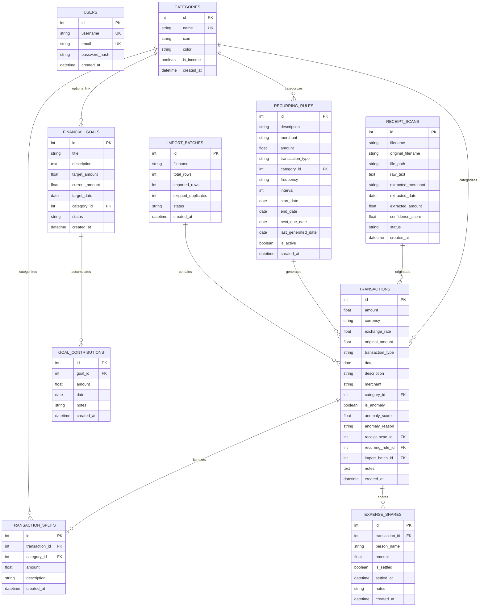

# Database Design & Schema Specification

## 1. Entity-Relationship Diagram (ERD)

---

## 2. Table Specifications & Indexes

### Table: `users`
Stores user credentials and session authentication data.

| Column | Type | Constraints | Description |
|---|---|---|---|
| `id` | `INTEGER` | PRIMARY KEY, AUTOINCREMENT | Unique user identifier |
| `username` | `VARCHAR(64)` | UNIQUE, NOT NULL, INDEX | Unique login handle |
| `email` | `VARCHAR(120)` | UNIQUE, NOT NULL, INDEX | Primary user email address |
| `password_hash` | `VARCHAR(256)` | NOT NULL | Salted PBKDF2 SHA-256 hash |
| `created_at`| `DATETIME` | DEFAULT CURRENT_TIMESTAMP | Account creation timestamp |

### Table: `categories`
Stores expense and income categories with UI display properties.

| Column | Type | Constraints | Description |
|---|---|---|---|
| `id` | `INTEGER` | PRIMARY KEY, AUTOINCREMENT | Unique category identifier |
| `name` | `VARCHAR(64)` | UNIQUE, NOT NULL, INDEX | Name of category (e.g. Food & Dining) |
| `icon` | `VARCHAR(32)` | DEFAULT 'tag' | Icon identifier |
| `color` | `VARCHAR(16)` | DEFAULT '#6B7280' | Hex color code for badges & charts |
| `is_income`| `BOOLEAN` | DEFAULT FALSE, NOT NULL | Flag separating income from expenses |
| `created_at`| `DATETIME` | DEFAULT CURRENT_TIMESTAMP | Record creation timestamp |

---

### Table: `transactions`
The core financial ledger recording all incoming and outgoing financial events.

| Column | Type | Constraints | Description |
|---|---|---|---|
| `id` | `INTEGER` | PRIMARY KEY, AUTOINCREMENT | Unique transaction identifier |
| `amount` | `FLOAT` | NOT NULL | Base normalized transaction amount (USD) |
| `currency` | `VARCHAR(3)` | DEFAULT 'USD', NOT NULL | Original ISO-4217 transaction currency |
| `exchange_rate` | `FLOAT` | DEFAULT 1.0, NOT NULL | Conversion rate against base USD |
| `original_amount`| `FLOAT` | NULLABLE | Pre-conversion numerical amount |
| `transaction_type` | `VARCHAR(16)` | DEFAULT 'expense', NOT NULL | 'expense' or 'income' |
| `date` | `DATE` | NOT NULL, INDEX | Transaction posting date |
| `description` | `VARCHAR(255)` | NOT NULL, INDEX | Transaction narrative / title |
| `merchant` | `VARCHAR(128)` | NULLABLE, INDEX | Normalized merchant / vendor name |
| `category_id` | `INTEGER` | FOREIGN KEY (`categories.id`), NOT NULL, INDEX | Assigned category |
| `is_anomaly` | `BOOLEAN` | DEFAULT FALSE, NOT NULL, INDEX | Anomaly detection flag |
| `anomaly_score` | `FLOAT` | NULLABLE | Mathematical anomaly severity (0-1) |
| `anomaly_reason` | `VARCHAR(255)` | NULLABLE | Plain-English explanation |
| `receipt_scan_id` | `INTEGER` | FOREIGN KEY (`receipt_scans.id`), NULLABLE | Source scanned receipt link |
| `recurring_rule_id`| `INTEGER` | FOREIGN KEY (`recurring_rules.id`), NULLABLE | Originating recurrence schedule |
| `import_batch_id` | `INTEGER` | FOREIGN KEY (`import_batches.id`), NULLABLE | Originating bank import batch |
| `notes` | `TEXT` | NULLABLE | User notes or audit remarks |
| `created_at` | `DATETIME` | DEFAULT CURRENT_TIMESTAMP | Audit timestamp |

---

### Table: `recurring_rules`
Defines automated recurrence schedules for subscriptions, bills, and income.

| Column | Type | Constraints | Description |
|---|---|---|---|
| `id` | `INTEGER` | PRIMARY KEY, AUTOINCREMENT | Unique rule identifier |
| `description` | `VARCHAR(255)` | NOT NULL | Schedule title |
| `merchant` | `VARCHAR(128)` | NULLABLE | Merchant / vendor |
| `amount` | `FLOAT` | NOT NULL | Recurring amount |
| `transaction_type` | `VARCHAR(16)` | DEFAULT 'expense', NOT NULL | 'expense' or 'income' |
| `category_id` | `INTEGER` | FOREIGN KEY (`categories.id`), NOT NULL | Target category |
| `frequency` | `VARCHAR(16)` | NOT NULL | 'daily', 'weekly', 'monthly', 'yearly' |
| `interval` | `INTEGER` | DEFAULT 1, NOT NULL | Frequency multiplier (every N units) |
| `start_date` | `DATE` | NOT NULL | Schedule inception date |
| `end_date` | `DATE` | NULLABLE | Optional expiration date |
| `next_due_date` | `DATE` | NOT NULL, INDEX | Next scheduled execution date |
| `last_generated_date`| `DATE` | NULLABLE | Last generated transaction date |
| `is_active` | `BOOLEAN` | DEFAULT TRUE, NOT NULL, INDEX | Active / paused toggle |
| `created_at` | `DATETIME` | DEFAULT CURRENT_TIMESTAMP | Record creation timestamp |

---

### Table: `financial_goals`
Tracks milestone savings targets and completion status.

| Column | Type | Constraints | Description |
|---|---|---|---|
| `id` | `INTEGER` | PRIMARY KEY, AUTOINCREMENT | Unique goal identifier |
| `title` | `VARCHAR(128)` | NOT NULL | Goal title (e.g. Emergency Fund) |
| `description` | `TEXT` | NULLABLE | Goal motivation / notes |
| `target_amount` | `FLOAT` | NOT NULL | Target savings sum |
| `current_amount` | `FLOAT` | DEFAULT 0.0, NOT NULL | Cumulative saved amount |
| `target_date` | `DATE` | NOT NULL | Target deadline |
| `category_id` | `INTEGER` | FOREIGN KEY (`categories.id`), NULLABLE | Optional linked category |
| `status` | `VARCHAR(16)` | DEFAULT 'in_progress', NOT NULL | 'in_progress', 'completed', 'paused' |
| `created_at` | `DATETIME` | DEFAULT CURRENT_TIMESTAMP | Record creation timestamp |

---

### Table: `goal_contributions`
Detailed deposit ledger for financial goal progress.

| Column | Type | Constraints | Description |
|---|---|---|---|
| `id` | `INTEGER` | PRIMARY KEY, AUTOINCREMENT | Contribution identifier |
| `goal_id` | `INTEGER` | FOREIGN KEY (`financial_goals.id`), NOT NULL | Linked goal |
| `amount` | `FLOAT` | NOT NULL | Deposited sum |
| `date` | `DATE` | NOT NULL | Contribution date |
| `notes` | `VARCHAR(255)` | NULLABLE | Deposit remarks |
| `created_at` | `DATETIME` | DEFAULT CURRENT_TIMESTAMP | Record creation timestamp |

---

### Table: `receipt_scans`
Audited repository of uploaded receipt images and OCR extraction metadata.

| Column | Type | Constraints | Description |
|---|---|---|---|
| `id` | `INTEGER` | PRIMARY KEY, AUTOINCREMENT | Scan identifier |
| `filename` | `VARCHAR(255)` | NOT NULL | Sanitized unique disk filename |
| `original_filename`| `VARCHAR(255)` | NOT NULL | User's uploaded filename |
| `file_path` | `VARCHAR(512)` | NOT NULL | Relative static storage path |
| `raw_text` | `TEXT` | NULLABLE | Full extracted OCR text |
| `extracted_merchant`| `VARCHAR(128)` | NULLABLE | Parsed merchant candidate |
| `extracted_date` | `DATE` | NULLABLE | Parsed transaction date |
| `extracted_amount`| `FLOAT` | NULLABLE | Parsed total amount |
| `confidence_score`| `FLOAT` | DEFAULT 0.0 | Composite extraction confidence |
| `status` | `VARCHAR(24)` | DEFAULT 'pending_review', NOT NULL | 'pending_review', 'confirmed', 'discarded'|
| `created_at` | `DATETIME` | DEFAULT CURRENT_TIMESTAMP | Upload timestamp |

---

### Table: `import_batches`
Audit logging for statement CSV and Excel ingestion batches.

| Column | Type | Constraints | Description |
|---|---|---|---|
| `id` | `INTEGER` | PRIMARY KEY, AUTOINCREMENT | Batch identifier |
| `filename` | `VARCHAR(255)` | NOT NULL | Statement filename |
| `total_rows` | `INTEGER` | DEFAULT 0, NOT NULL | Total rows present in file |
| `imported_rows` | `INTEGER` | DEFAULT 0, NOT NULL | Number of successfully imported transactions |
| `skipped_duplicates`| `INTEGER` | DEFAULT 0, NOT NULL | Number of duplicate rows detected and skipped |
| `status` | `VARCHAR(24)` | DEFAULT 'completed', NOT NULL | 'completed', 'failed', 'partial' |
| `created_at` | `DATETIME` | DEFAULT CURRENT_TIMESTAMP | Batch import timestamp |

---

### Table: `transaction_splits`
Stores itemized sub-allocations of a single master transaction across multiple categories.

| Column | Type | Constraints | Description |
|---|---|---|---|
| `id` | `INTEGER` | PRIMARY KEY, AUTOINCREMENT | Unique split identifier |
| `transaction_id` | `INTEGER` | FOREIGN KEY (`transactions.id`, CASCADE), NOT NULL, INDEX | Master transaction |
| `category_id` | `INTEGER` | FOREIGN KEY (`categories.id`), NOT NULL, INDEX | Sub-category allocation |
| `amount` | `FLOAT` | NOT NULL | Itemized sub-amount |
| `description` | `VARCHAR(255)` | NULLABLE | Item description / line note |
| `created_at` | `DATETIME` | DEFAULT CURRENT_TIMESTAMP | Record creation timestamp |

---

### Table: `expense_shares`
Tracks group expense sharing, IOUs, and debt settlement status for a transaction.

| Column | Type | Constraints | Description |
|---|---|---|---|
| `id` | `INTEGER` | PRIMARY KEY, AUTOINCREMENT | Unique share identifier |
| `transaction_id` | `INTEGER` | FOREIGN KEY (`transactions.id`, CASCADE), NOT NULL, INDEX | Master transaction |
| `person_name` | `VARCHAR(100)` | NOT NULL, INDEX | Debtor / friend name |
| `amount` | `FLOAT` | NOT NULL | Share amount owed |
| `is_settled` | `BOOLEAN` | DEFAULT FALSE, NOT NULL, INDEX | Settlement status |
| `settled_at` | `DATETIME` | NULLABLE | Timestamp when debt was settled |
| `notes` | `VARCHAR(255)` | NULLABLE | Share note or memo |
| `created_at` | `DATETIME` | DEFAULT CURRENT_TIMESTAMP | Record creation timestamp |

